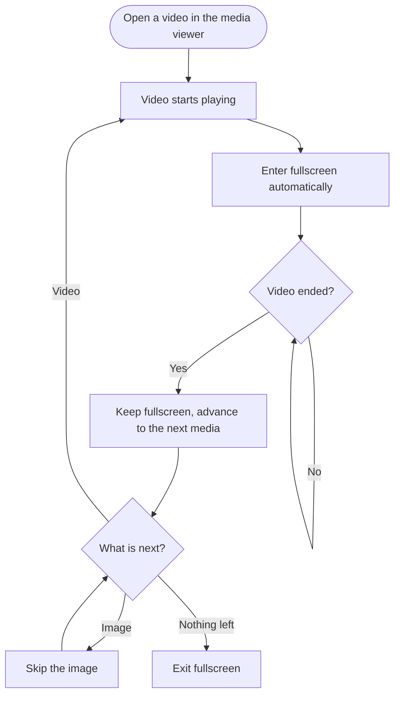

  

[简体中文](README.md) · **English**

---

> **A Tampermonkey userscript that turns the Telegram Web A media viewer into a video playlist.**
> Auto fullscreen on play, auto-play the next video when one ends, auto-skip images — all toggleable.

## Table of contents

- [Features](#features)
- [How it works](#how-it-works)
- [Installation (Tampermonkey)](#installation-tampermonkey)
- [Usage](#usage)
- [Menu commands](#menu-commands)
- [Playlist rules](#playlist-rules)
- [FAQ](#faq)
- [Compatibility](#compatibility)
- [Update & uninstall](#update--uninstall)
- [Development](#development)
- [Changelog](#changelog)
- [Contributing](#contributing)
- [Disclaimer](#disclaimer)
- [License](#license)

## Features

| | Feature | Description |
| --- | --- | --- |
| 🖥️ | Auto fullscreen | Enters full-page fullscreen as soon as a video starts playing |
| ⏭️ | Auto playlist | When a video ends, automatically advances to the next (or previous) video and plays it |
| 🖼️ | Skip images | Images in between are skipped automatically while searching for the next video |
| 🎛️ | Toggles | Playlist, auto fullscreen and skip images can be toggled independently, persisted locally |
| 🔁 | Looping videos | GIFs and other looping videos get `loop` disabled so they can finish and advance |
| 🧭 | Direction | Playlist can move forward or backward |
| 🌏 | i18n | Chinese-first UI text; English is shown in English environments |
| 🔒 | Privacy | Runs fully locally, collects nothing, uploads nothing |

## How it works

## Installation (Tampermonkey)

### Step 1: Install Tampermonkey

| Browser | Install |
| --- | --- |
| Chrome | [Chrome Web Store · Tampermonkey](https://chromewebstore.google.com/detail/tampermonkey/dhdgffkkebhmkfjojejmpbldmpobfkfo) |
| Edge | [Edge Add-ons · Tampermonkey](https://microsoftedge.microsoft.com/addons/detail/tampermonkey/iikmkjmpaadaobahmlepeloendndfphd) |
| Firefox | [Firefox Add-ons · Tampermonkey](https://addons.mozilla.org/firefox/addon/tampermonkey/) |
| Official site | [https://www.tampermonkey.net/](https://www.tampermonkey.net/) |

### Step 2: Enable Developer Mode (Chrome / Edge)

Recent Chrome / Edge versions require the extension developer mode to let Tampermonkey run
third-party userscripts:

- **Chrome**: open `chrome://extensions` → turn on **Developer mode** (top-right).
- **Edge**: open `edge://extensions` → turn on **Developer mode** (left sidebar).

### Step 3: Install the script

**Option A (recommended)**

Click the button below; Tampermonkey will open the install page — confirm with **Install**:

If your browser only shows the source code, copy everything and use Option B.

**Option B (manual paste)**

1. Click the Tampermonkey icon → **Dashboard**;
2. Open the **Installed Userscripts** tab → click **+** to create a new script;
3. Replace the template with the full content of [`telegram-web-a-video-playlist.user.js`](https://raw.githubusercontent.com/shixin-qiao/telegram-web-a-video-playlist/main/telegram-web-a-video-playlist.user.js);
4. Press `Ctrl + S` (`Cmd + S` on macOS) to save.

### Step 4: Verify

1. Open [Telegram Web A](https://web.telegram.org/a/) and sign in;
2. Open any chat and click a video;
3. Expected: the video goes fullscreen and plays; when it ends, the next video starts automatically;
4. To confirm the script is running: press `F12`, filter the console by `[TG Playlist]`.

## Usage

1. Open [Telegram Web A](https://web.telegram.org/a/) and enter a chat with videos;
2. Click a video — the script goes fullscreen and starts the playlist;
3. Press `Esc` to leave fullscreen;
4. Click the Tampermonkey icon to open the menu and change the behavior.

## Menu commands

Tampermonkey icon → **Telegram Web A 视频播完自动切换** → choose a command:

| Menu command | Effect | Default |
| --- | --- | --- |
| Direction: Next ▶ | Advance to the next media after a video ends | ✅ |
| Direction: Previous ◀ | Advance to the previous media | |
| Auto Fullscreen: On / Off | Enter fullscreen when a video starts | On |
| Playlist: On / Off | Automatically advance when a video ends | On |
| Skip Images: On / Off | Skip images while advancing | On |

> The UI follows the browser language: Chinese-first, English in English environments.

## Playlist rules

1. **Play** — entering a video in the media viewer starts it and enters full-page fullscreen;
2. **Ended** — fullscreen is kept while advancing to the next media;
3. **Image** — skipped when "Skip images" is on; stops on the image when it is off;
4. **Video** — starts playing automatically and keeps the playlist going;
5. **Nothing left** — exits fullscreen;
6. **Viewer closed** — exits fullscreen and resets the session state;
7. **Manual fullscreen exit** — this viewer session will not force fullscreen again.

## FAQ

<b>Why didn't the video go fullscreen?</b>

The Fullscreen API requires a user gesture. Opening a video from a chat usually counts, but
some browsers may still block the automatic request — click play once and the script retries.
Check the console for `[TG Playlist]` hints.

<b>Why didn't it advance to the next video?</b>

Common reasons: it is the last media; the **Playlist** toggle is off; the tab was in the
background; or the video was not opened inside the media viewer. Otherwise please open an issue
with the `[TG Playlist]` logs.

<b>Why does it stay fullscreen until the very last video?</b>

Browsers only grant fullscreen shortly after a user gesture. Re-entering fullscreen for every
auto-advanced video would be blocked. Keeping fullscreen for the whole playlist is the stable
approach; it exits when the playlist ends, the viewer closes, or you press `Esc`.

<b>Does it support Telegram Web K (/k/)?</b>

Not yet. Only Web A (`web.telegram.org/a/*`) is supported; Web K uses a different media viewer DOM.

<b>Does it collect any data?</b>

No. The script runs fully locally, sends no requests and only interacts with the media viewer DOM
and the browser Fullscreen API.

<b>How to update or uninstall?</b>

Tampermonkey checks `@updateURL` automatically; you can also use **Check for updates** in the
dashboard. To uninstall, delete the script from the Tampermonkey dashboard.

## Compatibility

| Item | Status |
| --- | --- |
| Telegram Web A (`web.telegram.org/a/*`) | ✅ Supported |
| Telegram Web K (`/k/`) | ❌ Not supported |
| Chrome / Edge (Chromium) | ✅ Primary target |
| Firefox | ⚠️ Should work, not fully tested |
| Safari | ⚠️ Not tested |
| Mobile browsers | ❌ Not applicable |

## Update & uninstall

- Automatic update via Tampermonkey's `@updateURL` check;
- Manual update: Dashboard → **Installed Userscripts** → **Check for updates**;
- Uninstall: delete the script in the dashboard, or remove Tampermonkey itself.

## Development

Single-file userscript, no build step:

- Media state: read the video/image inside `#MediaViewer[open] .MediaViewerSlide--active`;
- Navigation: dispatch `ArrowRight` / `ArrowLeft` keyboard events on `document`;
- Fullscreen: `documentElement.requestFullscreen()` on first play, kept during the playlist;
- Playlist: `ended` → wait for the media to change → skip images → `play()` the next video.

Debug with the `[TG Playlist]` console prefix.

## Changelog

See [CHANGELOG.md](./CHANGELOG.md).

- **1.5.0** — playlist / skip-images toggles and Chinese/English UI
- **1.4.0** — keep fullscreen during the playlist; fix blocked second fullscreen request
- **1.3.0** — auto fullscreen, exit fullscreen before advancing
- **1.2.0** — auto-advance and skip images
- **1.1.0** — auto-advance to next/previous media

## Contributing

Issues and pull requests are welcome — see [CONTRIBUTING.md](./CONTRIBUTING.md).

## Disclaimer

This is a personal browser userscript, not affiliated with or endorsed by Telegram.
Please follow the [Telegram Terms of Service](https://telegram.org/tos) and your local laws.
The script only improves the web playback experience; it does not bypass access controls.
Use at your own risk.

## License

[MIT](./LICENSE) © 2026 Qiao Shixin
