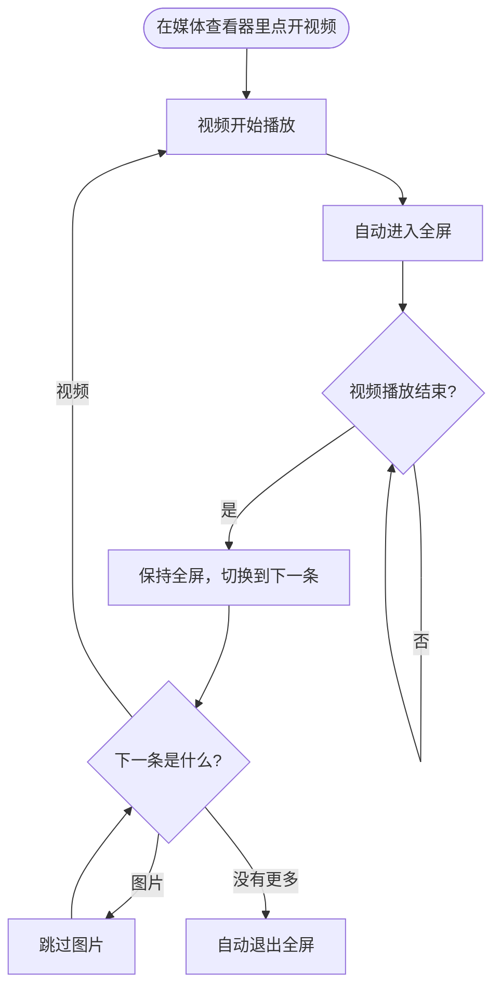

  

**简体中文** · [English](README.en.md)

---

> **Telegram Web A 媒体查看器视频连播器（篡改猴用户脚本）。**
> 视频开始播放自动全屏；播完自动连播下一条；图片自动跳过；连播 / 全屏 / 跳过图片均可独立开关。

## 目录

- [功能特性](#功能特性)
- [工作流程](#工作流程)
- [安装教程（篡改猴）](#安装教程篡改猴)
- [使用方法](#使用方法)
- [菜单命令](#菜单命令)
- [连播规则](#连播规则)
- [常见问题](#常见问题)
- [兼容性](#兼容性)
- [更新与卸载](#更新与卸载)
- [开发与测试](#开发与测试)
- [更新日志](#更新日志)
- [贡献](#贡献)
- [免责声明](#免责声明)
- [许可证](#许可证)

## 功能特性

| | 功能 | 说明 |
| --- | --- | --- |
| 🖥️ | 自动全屏 | 视频开始播放时自动进入整页全屏，浏览器地址栏隐藏，沉浸观看 |
| ⏭️ | 自动连播 | 当前视频播放结束后，自动切换到下一条（或上一条）视频并开始播放 |
| 🖼️ | 跳过图片 | 连播途中遇到图片会自动继续向后找，直达下一个视频 |
| 🎛️ | 独立开关 | 连播、自动全屏、跳过图片各自可开关，设置保存在本地，刷新不丢 |
| 🔁 | 循环视频 | GIF 等循环视频会先关闭 `loop`，播放一遍后参与连播 |
| 🧭 | 方向可选 | 支持「下一条」和「上一条」两个播放方向 |
| 🌏 | 中英双语 | 界面文案中文优先，仅英文环境显示英文 |
| 🔒 | 隐私友好 | 纯本地脚本，不收集、不上传任何数据 |

## 工作流程

## 安装教程（篡改猴）

### 第 1 步：安装 Tampermonkey（篡改猴）

Tampermonkey 是最流行的用户脚本管理器，先在你的浏览器里安装它：

| 浏览器 | 安装地址 |
| --- | --- |
| Chrome | [Chrome 应用商店 · Tampermonkey](https://chromewebstore.google.com/detail/tampermonkey/dhdgffkkebhmkfjojejmpbldmpobfkfo) |
| Edge | [Edge 加载项 · Tampermonkey](https://microsoftedge.microsoft.com/addons/detail/tampermonkey/iikmkjmpaadaobahmlepeloendndfphd) |
| Firefox | [Firefox 附加组件 · Tampermonkey](https://addons.mozilla.org/firefox/addon/tampermonkey/) |
| 官方网站 | [https://www.tampermonkey.net/](https://www.tampermonkey.net/) |

安装完成后，浏览器工具栏会出现 Tampermonkey 图标（黑白方块）。

### 第 2 步：开启开发者模式（Chrome / Edge 必看）

较新版本的 Chrome / Edge 对用户脚本有额外限制，需要开启浏览器扩展的「开发者模式」，Tampermonkey 才能正常运行第三方脚本：

- **Chrome**：地址栏输入 `chrome://extensions` → 打开右上角的「开发者模式」开关。
- **Edge**：地址栏输入 `edge://extensions` → 打开左侧的「开发人员模式」开关。

> 如果 Tampermonkey 弹出提示要求开启开发者模式，按提示操作即可。已经开启过的可以跳过这一步。

### 第 3 步：安装本脚本

**方式 A（推荐，一键安装）**

点击下面的按钮，Tampermonkey 会自动打开安装页面，确认后点「安装」：

如果浏览器只是显示了脚本源码，可以复制全部内容，用方式 B 安装。

**方式 B（手动粘贴）**

1. 点击浏览器工具栏的 Tampermonkey 图标 → 「仪表盘」；
2. 切换到「已安装脚本」标签，点击「+」新建脚本；
3. 删除编辑器里的模板内容，粘贴本仓库的 [`telegram-web-a-video-playlist.user.js`](https://raw.githubusercontent.com/shixin-qiao/telegram-web-a-video-playlist/main/telegram-web-a-video-playlist.user.js) 全部内容；
4. 按 `Ctrl + S`（macOS 为 `Cmd + S`）保存。

### 第 4 步：验证安装

1. 打开 [Telegram Web A](https://web.telegram.org/a/) 并登录；
2. 进入任意聊天，点开一个视频；
3. 正常表现：视频自动全屏播放，播放结束后自动切到下一条；
4. 想确认脚本在运行：按 `F12` 打开控制台，筛选 `[TG Playlist]`，能看到连播日志。

> 首次使用时，浏览器可能询问是否允许全屏，请选择允许；如果视频没有自动全屏，手动点一下播放即可（浏览器要求全屏必须由用户操作触发）。

## 使用方法

1. 打开 [Telegram Web A](https://web.telegram.org/a/)，进入有视频的聊天；
2. 点开任意视频，脚本会自动全屏并开始连播；
3. 想退出全屏：按 `Esc`；
4. 想暂停连播或修改行为：点击 Tampermonkey 图标，在菜单中选择对应命令。

## 菜单命令

点击浏览器工具栏的 **Tampermonkey 图标** → **Telegram Web A 视频播完自动切换** → 选择命令：

| 菜单命令 | 作用 | 默认 |
| --- | --- | --- |
| 切换方向：下一条 ▶ | 播放结束后切到下一条 | ✅ |
| 切换方向：上一条 ◀ | 播放结束后切到上一条 | |
| 自动全屏：开 / 关 | 视频开始播放时是否自动全屏 | 开 |
| 连播：开 / 关 | 视频播完是否自动切换下一条 | 开 |
| 跳过图片：开 / 关 | 连播时遇到图片是否跳过 | 开 |

> 语言说明：脚本会读取浏览器语言，中文环境显示中文菜单，英文环境显示英文菜单，其他语言默认中文。

## 连播规则

1. **开始播放**：视频开始播放 → 自动进入整页全屏；
2. **播放结束**：保持全屏，自动切到下一条媒体；
3. **遇到图片**：「跳过图片」开启时继续向后找，关闭时停在这张图片上；
4. **遇到视频**：自动开始播放，继续下一轮连播；
5. **没有更多媒体**：自动退出全屏；
6. **关闭查看器**：退出全屏并重置本次会话状态；
7. **手动退出全屏**：本次查看器会话不再自动全屏（浏览器在无用户手势时也无法再次进入全屏）。

## 常见问题

<b>为什么视频没有自动全屏？</b>

浏览器要求全屏 API 必须由用户操作触发（Fullscreen API 的 transient activation 限制）。
从聊天里点开视频时通常可以直接全屏；如果被浏览器拦截，手动点一下播放即可，脚本会在下次播放时重试。
也可以在控制台筛选 `[TG Playlist]` 查看是否有拦截提示。

<b>为什么播完没有自动切下一条？</b>

常见原因：
1. 当前已经是最后一条媒体；
2. 「连播」开关被关闭了（Tampermonkey 菜单里检查）；
3. 播放结束后页面被切到了后台；
4. 视频不是通过媒体查看器打开的（脚本只处理媒体查看器里的视频）。

如果都不是，欢迎按 Issue 模板反馈并附上 `[TG Playlist]` 日志。

<b>为什么连播时一直全屏，播完最后一条才退出？</b>

这是刻意的设计。浏览器只允许在用户操作后的一小段时间内进入全屏；连播是脚本自动触发的，如果每条播完都退出再重新全屏，第二次全屏会被浏览器拒绝。
因此连播期间保持全屏，直到最后一条播完、关闭查看器或你手动退出。

<b>支持 Telegram Web K（/k/）吗？</b>

目前只支持 Web A（`web.telegram.org/a/*`）。Web K 的媒体查看器使用另一套 DOM，尚未适配。

<b>会收集我的数据吗？</b>

不会。脚本完全在本地运行，不发送任何网络请求，不读取聊天内容，只操作媒体查看器的 DOM 与浏览器全屏 API。

<b>会影响 Telegram 的下载、转发等功能吗？</b>

不会。脚本只监听视频播放结束、模拟方向键切换媒体，并控制全屏；不修改 Telegram 的下载、转发、举报等逻辑。

<b>如何更新？</b>

Tampermonkey 默认会自动检查脚本更新（可在设置里调整频率）。也可以打开 Tampermonkey 仪表盘 →「已安装脚本」→ 选择本脚本 →「检查更新」。

<b>如何卸载？</b>

打开 Tampermonkey 仪表盘 →「已安装脚本」→ 本脚本右侧的删除按钮；或直接在浏览器扩展里卸载 Tampermonkey。

<b>如何反馈问题？</b>

使用 [Issue 模板](https://github.com/shixin-qiao/telegram-web-a-video-playlist/issues/new/choose) 提交，并附上浏览器版本、脚本版本、复现步骤和 `[TG Playlist]` 控制台日志。

## 兼容性

| 项目 | 支持情况 |
| --- | --- |
| Telegram Web A（`web.telegram.org/a/*`） | ✅ 支持 |
| Telegram Web K（`/k/`） | ❌ 暂不支持 |
| Chrome / Edge（Chromium 内核） | ✅ 主要测试环境 |
| Firefox | ⚠️ 理论可用，未完整测试 |
| Safari | ⚠️ 未测试 |
| 移动端浏览器 | ❌ 不适用（无 Tampermonkey 桌面环境） |

## 更新与卸载

- **自动更新**：Tampermonkey 会按 `@updateURL` 检查新版本；
- **手动更新**：Tampermonkey 仪表盘 →「已安装脚本」→「检查更新」；
- **卸载**：Tampermonkey 仪表盘删除脚本，或在扩展管理中移除 Tampermonkey。

## 开发与测试

脚本为单文件用户脚本，无构建依赖，核心逻辑：

- 媒体状态：读取 `#MediaViewer[open]` 中 `.MediaViewerSlide--active` 的视频/图片；
- 切换媒体：向 `document` 派发 `ArrowRight` / `ArrowLeft` 键盘事件；
- 全屏：首次播放时对 `documentElement` 调用 `requestFullscreen()`，连播期间保持；
- 连播：`ended` 事件 → 等待媒体切换 → 跳过图片 → 新视频 `play()`。

本地验证方式：在 Tampermonkey 中新建脚本粘贴代码调试；控制台关键词 `[TG Playlist]`。

## 更新日志

完整版本记录见 [CHANGELOG.md](./CHANGELOG.md)。

- **1.5.0**：新增连播 / 跳过图片开关与中英双语界面
- **1.4.0**：连播全程保持全屏，修复连播时二次全屏被浏览器拒绝的问题
- **1.3.0**：自动全屏 + 播完退出全屏再切下一条
- **1.2.0**：视频播完自动切换 + 跳过图片
- **1.1.0**：视频播完切换到下一条 / 上一条

## 贡献

欢迎提交 Issue 和 Pull Request，详见 [CONTRIBUTING.md](./CONTRIBUTING.md)。

## 免责声明

本项目是个人开发的浏览器用户脚本，与 Telegram 官方无关，未获得其认可或授权。
请遵守 [Telegram 服务条款](https://telegram.org/tos) 及你所在地区的法律法规。脚本仅用于改善网页端播放体验，不提供任何绕过访问控制的能力，使用者需自行承担使用风险。

## 许可证

[MIT](./LICENSE) © 2026 Qiao Shixin
