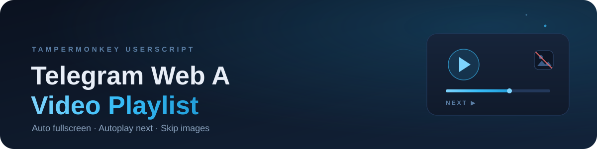
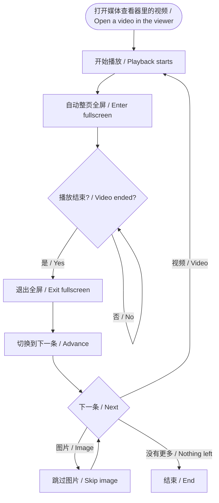

  

**中文** ｜ **English** — 本页同页双语，无需切换 / This page is bilingual, no switching needed

---

> **Telegram Web A 媒体查看器视频连播器（篡改猴用户脚本）。**
> 视频开始播放自动全屏；播完自动退出全屏并连播下一条；图片自动跳过；连播 / 全屏 / 跳过图片均可独立开关。
>
> **A Tampermonkey userscript that turns the Telegram Web A media viewer into a video playlist.**
> Auto fullscreen on play, auto-advance to the next video when one ends, auto-skip images — all toggleable.

## 目录 / Contents

- [功能特性 / Features](#功能特性--features)
- [工作流程 / How it works](#工作流程--how-it-works)
- [安装教程（篡改猴）/ Installation](#安装教程篡改猴--installation)
- [使用方法 / Usage](#使用方法--usage)
- [菜单命令 / Menu commands](#菜单命令--menu-commands)
- [连播规则 / Playlist rules](#连播规则--playlist-rules)
- [常见问题 / FAQ](#常见问题--faq)
- [兼容性 / Compatibility](#兼容性--compatibility)
- [更新与卸载 / Update & uninstall](#更新与卸载--update--uninstall)
- [开发与测试 / Development](#开发与测试--development)
- [更新日志 / Changelog](#更新日志--changelog)
- [贡献 / Contributing](#贡献--contributing)
- [免责声明 / Disclaimer](#免责声明--disclaimer)
- [许可证 / License](#许可证--license)

## 功能特性 / Features

| 功能 / Feature | 说明 / Description |
| --- | --- |
| 🖥️ 自动全屏 / Auto fullscreen | 视频开始播放时自动进入整页全屏。 / Enters page-level fullscreen when a video starts playing. |
| ⏭️ 自动连播 / Auto playlist | 视频播完后自动切换到下一条（或上一条）并开始播放。 / Advances to the next (or previous) video and starts playing it. |
| 🖼️ 跳过图片 / Skip images | 连播途中遇到图片会自动继续向后找，直达下一个视频。 / Skips images while searching for the next video. |
| 🔁 循环视频 / Looping videos | GIF 等循环视频会先关闭 `loop`，播放一遍后参与连播。 / Disables `loop` on GIFs so they can finish and advance. |
| 🧭 方向可选 / Direction | 支持「下一条」和「上一条」两个播放方向。 / Supports forward and backward playlists. |
| 🎛️ 独立开关 / Toggles | 连播、自动全屏、跳过图片各自可开关，设置保存在本地。 / Playlist, auto fullscreen and image skipping are individually toggleable and persisted locally. |
| 🌏 中英双语 / Bilingual UI | 脚本界面中文优先，仅英文环境显示英文。 / Chinese-first UI; English is shown in English environments. |
| 🔒 隐私友好 / Privacy | 纯本地脚本，不收集、不上传任何数据。 / Runs fully locally, collects and uploads nothing. |

> ⚠️ **全屏限制说明 / Fullscreen caveat**：只要页面处于 Fullscreen API 全屏状态，Telegram Web A 就会开启视频原生控件（与自身控件叠加）并禁用媒体查看器的方向键/按钮导航，这是 Telegram 自身的行为。脚本会在视频播完后自动退出全屏再连播，避免切换失效。
> Whenever the page is in Fullscreen API mode, Telegram Web A enables native video controls (stacking with its own) and disables the media viewer's keyboard/button navigation — that is Telegram's own behavior. The script exits fullscreen after each video before advancing.

## 工作流程 / How it works

## 安装教程（篡改猴）/ Installation

### 第 1 步 / Step 1：安装 Tampermonkey · Install Tampermonkey

Tampermonkey 是最流行的用户脚本管理器，先在你的浏览器里安装它。
Tampermonkey is the most popular userscript manager — install it in your browser first.

| 浏览器 / Browser | 安装地址 / Install |
| --- | --- |
| Chrome | [Chrome 应用商店 · Tampermonkey](https://chromewebstore.google.com/detail/tampermonkey/dhdgffkkebhmkfjojejmpbldmpobfkfo) |
| Edge | [Edge 加载项 · Tampermonkey](https://microsoftedge.microsoft.com/addons/detail/tampermonkey/iikmkjmpaadaobahmlepeloendndfphd) |
| Firefox | [Firefox 附加组件 · Tampermonkey](https://addons.mozilla.org/firefox/addon/tampermonkey/) |
| 官方网站 / Official site | [https://www.tampermonkey.net/](https://www.tampermonkey.net/) |

安装完成后，浏览器工具栏会出现 Tampermonkey 图标（黑白方块）。
After installation, a Tampermonkey icon (black-and-white square) appears in the browser toolbar.

### 第 2 步 / Step 2：开启开发者模式 · Enable Developer Mode（Chrome / Edge）

较新版本的 Chrome / Edge 对用户脚本有额外限制，需要开启浏览器扩展的「开发者模式」。
Recent Chrome / Edge versions require the extension developer mode for third-party userscripts.

- **Chrome**：地址栏输入 `chrome://extensions` → 打开右上角的「开发者模式」开关。
  Open `chrome://extensions` → turn on **Developer mode** (top-right).
- **Edge**：地址栏输入 `edge://extensions` → 打开左侧的「开发人员模式」开关。
  Open `edge://extensions` → turn on **Developer mode** (left sidebar).

> 如果 Tampermonkey 弹出提示要求开启开发者模式，按提示操作即可。已经开启过的可以跳过这一步。
> If Tampermonkey prompts you to enable developer mode, follow the prompt. Skip this step if it is already enabled.

### 第 3 步 / Step 3：安装本脚本 · Install the script

**方式 A（推荐，一键安装）/ Option A (recommended)**

点击下面的按钮，Tampermonkey 会自动打开安装页面，确认后点「安装」。
Click the button below; Tampermonkey opens the install page — confirm with **Install**.

如果浏览器只是显示了脚本源码，可以复制全部内容，用方式 B 安装。
If the browser only shows the source code, copy everything and use Option B.

**方式 B（手动粘贴）/ Option B (manual paste)**

1. 点击浏览器工具栏的 Tampermonkey 图标 →「仪表盘」。
   Click the Tampermonkey icon → **Dashboard**.
2. 切换到「已安装脚本」标签，点击「+」新建脚本。
   Open the **Installed Userscripts** tab → click **+**.
3. 删除编辑器里的模板内容，粘贴本仓库的 [`telegram-web-a-video-playlist.user.js`](https://raw.githubusercontent.com/shixin-qiao/telegram-web-a-video-playlist/main/telegram-web-a-video-playlist.user.js) 全部内容。
   Replace the template with the whole file.
4. 按 `Ctrl + S`（macOS 为 `Cmd + S`）保存。
   Press `Ctrl + S` (`Cmd + S` on macOS) to save.

### 第 4 步 / Step 4：验证安装 · Verify

1. 打开 [Telegram Web A](https://web.telegram.org/a/) 并登录。
   Open [Telegram Web A](https://web.telegram.org/a/) and sign in.
2. 进入任意聊天，点开一个视频。
   Open any chat and click a video.
3. 正常表现：视频自动全屏播放，播放结束后退出全屏并切到下一条。
   Expected: the video goes fullscreen, and when it ends the viewer exits fullscreen and advances.
4. 想确认脚本在运行：按 `F12` 打开控制台，筛选 `[TG Playlist]`。
   To confirm the script is running: press `F12` and filter the console by `[TG Playlist]`.

> 首次使用时，浏览器可能询问是否允许全屏，请选择允许；如果视频没有自动全屏，手动点一下播放即可（浏览器要求全屏必须由用户操作触发）。
> The browser may ask for fullscreen permission on first use — allow it. If a video does not go fullscreen, click play once; the Fullscreen API requires a user gesture.

## 使用方法 / Usage

1. 打开 [Telegram Web A](https://web.telegram.org/a/)，进入有视频的聊天。
   Open [Telegram Web A](https://web.telegram.org/a/) and enter a chat with videos.
2. 点开任意视频，脚本会自动全屏并开始连播。
   Click a video — the script goes fullscreen and starts the playlist.
3. 想退出全屏：按 `Esc`。
   Press `Esc` to leave fullscreen.
4. 想暂停连播或修改行为：点击 Tampermonkey 图标，在菜单中选择对应命令。
   Click the Tampermonkey icon and choose a menu command.

## 菜单命令 / Menu commands

点击浏览器工具栏的 **Tampermonkey 图标** → **Telegram Web A 视频播完自动切换** → 选择命令。
Tampermonkey icon → **Telegram Web A 视频播完自动切换** → choose a command.

| 菜单命令 / Command | 作用 / Effect | 默认 / Default |
| --- | --- | --- |
| 切换方向：下一条 ▶ / Direction: Next ▶ | 播放结束后切到下一条。 / Advance to the next media after a video ends. | ✅ |
| 切换方向：上一条 ◀ / Direction: Previous ◀ | 播放结束后切到上一条。 / Advance to the previous media. | |
| 自动全屏：开 / 关 / Auto Fullscreen: On / Off | 视频开始播放时是否自动全屏。 / Enter fullscreen when a video starts. | 开 / On |
| 连播：开 / 关 / Playlist: On / Off | 视频播完是否自动切换下一条。 / Advance automatically when a video ends. | 开 / On |
| 跳过图片：开 / 关 / Skip Images: On / Off | 连播时遇到图片是否跳过。 / Skip images while advancing. | 开 / On |

> 语言说明：脚本读取浏览器语言，中文环境显示中文菜单，英文环境显示英文菜单，其他语言默认中文。
> Language: the UI follows the browser language — Chinese-first, English in English environments.

## 连播规则 / Playlist rules

1. **开始播放 / Play**：视频开始播放 → 尝试自动进入整页全屏。
   When a video starts playing, the script tries to enter page-level fullscreen.
2. **播放结束 / Ended**：先退出全屏（Telegram 在全屏状态下会禁用查看器导航），再切换到下一条媒体。
   When the video ends, the script exits fullscreen first (Telegram disables viewer navigation while fullscreen), then advances.
3. **遇到图片 / Image**：「跳过图片」开启时继续向后找；关闭时停在这张图片上。
   Images are skipped when **Skip images** is on; with it off, the playlist stops on the image.
4. **遇到视频 / Video**：自动开始播放，并尝试再次自动全屏。
   The next video starts playing automatically and the script tries to enter fullscreen again.
5. **没有更多媒体 / Nothing left**：结束连播。
   The playlist ends.
6. **关闭查看器 / Viewer closed**：退出全屏并重置本次会话状态。
   Exits fullscreen and resets the session state.
7. **手动退出全屏 / Manual exit**：本次查看器会话不再自动全屏（关闭查看器重新打开后恢复）。
   Auto fullscreen is disabled for this viewer session (it is restored after reopening the viewer).

## 常见问题 / FAQ

<b>为什么视频没有自动全屏？ / Why didn't the video go fullscreen?</b>

浏览器要求全屏 API 必须由用户操作触发（transient activation 限制）。从聊天里点开视频时通常可以直接全屏；如果被拦截，手动点一下播放即可，脚本会在下次播放时重试，控制台 `[TG Playlist]` 会给出提示。
The Fullscreen API requires a user gesture. Opening a video from a chat usually works; if blocked, click play once and the script retries on the next play — check the `[TG Playlist]` console log.

<b>为什么全屏时出现双重进度条、上一条/下一条按钮失灵？ / Why do I see double progress bars and broken prev/next buttons in fullscreen?</b>

这是 Telegram Web A 自身的行为：只要 page 处于 Fullscreen API 全屏状态，它就会给视频打开浏览器原生控件（与自己的控件叠加成双重进度条），并注销媒体查看器的方向键/点击导航，所以上一条/下一条按钮在全屏时不可用。脚本会在视频播完后自动退出全屏，退出后控件和导航恢复正常。
This is Telegram Web A's own behavior: whenever the page is in Fullscreen API mode, it enables native video controls (stacking with its own) and disables the media viewer's keyboard/click navigation. The script exits fullscreen right after each video, and controls/navigation come back.

<b>为什么连播后面几条没有全屏？ / Why do later videos in the playlist not go fullscreen?</b>

浏览器规定 Fullscreen API 必须由用户手势触发。自动连播切换视频时没有新的用户操作，浏览器可能拒绝再次全屏 —— 脚本会保持普通模式继续连播，不会中断。想全屏时可以手动点一下 Telegram 播放器的全屏按钮，或按一下页面任意位置后重新播放。
The Fullscreen API requires a user gesture. Automatically advancing videos have no fresh gesture, so the browser may reject re-entering fullscreen; the playlist continues in normal mode. Use Telegram's own fullscreen button when you want fullscreen.

<b>为什么播完没有自动切下一条？ / Why didn't it advance after the video ended?</b>

常见原因 / Common reasons:
1. 当前已经是最后一条媒体 / it is the last media;
2. 「连播」开关被关闭 / the **Playlist** toggle is off;
3. 播放结束后页面被切到后台 / the tab was in the background;
4. 视频不是通过媒体查看器打开的 / the video was not opened in the media viewer。

如果都不是，请按 Issue 模板反馈并附上 `[TG Playlist]` 日志。
Otherwise, open an issue with the `[TG Playlist]` logs.

<b>支持 Telegram Web K（/k/）吗？ / Does it support Web K?</b>

目前只支持 Web A（`web.telegram.org/a/*`）。Web K 的媒体查看器 DOM 不同，尚未适配。
Currently only Web A (`web.telegram.org/a/*`). Web K uses a different media viewer DOM and is not supported yet.

<b>会收集我的数据吗？ / Does it collect any data?</b>

不会。脚本完全在本地运行，不发送网络请求，不读取聊天内容，只操作媒体查看器 DOM 与浏览器全屏 API。
No. It runs fully locally, sends no requests, reads no chat content, and only interacts with the media viewer DOM and the Fullscreen API.

<b>会影响 Telegram 的下载、转发等功能吗？ / Does it affect downloading or forwarding?</b>

不会。脚本只监听视频播放结束、模拟方向键切换媒体并控制全屏，不修改 Telegram 的下载、转发、举报等逻辑。
No. It only listens for video end, dispatches arrow keys to switch media and controls fullscreen.

<b>如何更新或卸载？ / How to update or uninstall?</b>

Tampermonkey 会按 `@updateURL` 自动检查更新，也可以在仪表盘「已安装脚本」中手动检查。卸载：在 Tampermonkey 仪表盘删除脚本，或直接移除 Tampermonkey。
Tampermonkey checks `@updateURL` automatically; you can also use **Check for updates** in the dashboard. To uninstall, delete the script in the dashboard or remove Tampermonkey.

<b>如何反馈问题？ / How to report an issue?</b>

使用 [Issue 模板](https://github.com/shixin-qiao/telegram-web-a-video-playlist/issues/new/choose)，附上浏览器版本、脚本版本、复现步骤和 `[TG Playlist]` 控制台日志。
Use the issue template with your browser/script version, steps to reproduce and the `[TG Playlist]` console logs.

## 兼容性 / Compatibility

| 项目 / Item | 支持情况 / Status |
| --- | --- |
| Telegram Web A（`web.telegram.org/a/*`） | ✅ 支持 / Supported |
| Telegram Web K（`/k/`） | ❌ 暂不支持 / Not supported |
| Chrome / Edge（Chromium 内核 / Chromium-based） | ✅ 主要测试环境 / Primary target |
| Firefox | ⚠️ 理论可用，未完整测试 / Should work, not fully tested |
| Safari | ⚠️ 未测试 / Not tested |
| 移动端浏览器 / Mobile browsers | ❌ 不适用 / Not applicable |

## 更新与卸载 / Update & uninstall

- **自动更新 / Auto update**：Tampermonkey 会按 `@updateURL` 检查新版本。
  Tampermonkey checks `@updateURL` automatically.
- **手动更新 / Manual update**：Tampermonkey 仪表盘 →「已安装脚本」→「检查更新」。
  Dashboard → Installed Userscripts → **Check for updates**.
- **卸载 / Uninstall**：Tampermonkey 仪表盘删除脚本，或在扩展管理中移除 Tampermonkey。
  Delete the script in the dashboard, or remove Tampermonkey itself.

## 开发与测试 / Development

脚本为单文件用户脚本，无构建依赖，核心逻辑：
A single-file userscript with no build step. Core logic:

- 媒体状态 / media state：读取 `#MediaViewer[open]` 中 `.MediaViewerSlide--active` 的视频/图片。
  Reads the video/image inside `#MediaViewer[open] .MediaViewerSlide--active`.
- 切换媒体 / navigation：向 `document` 派发 `ArrowRight` / `ArrowLeft` 键盘事件。
  Dispatches `ArrowRight` / `ArrowLeft` keyboard events on `document`.
- 全屏 / fullscreen：首次播放时对 `documentElement` 调用 `requestFullscreen()`；播放结束先退出全屏再切换。
  Calls `documentElement.requestFullscreen()` on first play; exits fullscreen before advancing.
- 连播 / playlist：`ended` 事件 → 退出全屏 → 等待媒体切换 → 跳过图片 → 新视频 `play()` 并尝试全屏。
  `ended` → exit fullscreen → wait for the media to change → skip images → `play()` the next video and try fullscreen again.
- 日志 / logs：控制台关键词 `[TG Playlist]`。
  Console prefix: `[TG Playlist]`.

本地调试 / Local debugging：在 Tampermonkey 中新建脚本粘贴代码即可 / paste the script into a new Tampermonkey script.

## 更新日志 / Changelog

完整版本记录见 [CHANGELOG.md](./CHANGELOG.md)。
See [CHANGELOG.md](./CHANGELOG.md) for the full changelog.

- **1.6.0**：播完先退出全屏再连播，修复全屏时双重控件与导航失灵。
  Exit fullscreen before advancing; fixed double controls and broken navigation in fullscreen.
- **1.5.3**：修复连播时全屏状态误判（手动退出与切换退出混淆）。
  Fixed fullscreen state misdetection during playlists.
- **1.5.2**：修复个别图片（懒加载）识别失败导致连播中断。
  Fixed lazy-loaded images not being recognized.
- **1.5.1**：SVG 双箭头脚本图标。
  SVG double-arrow icon.
- **1.5.0**：连播 / 跳过图片开关与中英双语界面。
  Playlist / skip-images toggles and bilingual UI.

## 贡献 / Contributing

欢迎提交 Issue 和 Pull Request，详见 [CONTRIBUTING.md](./CONTRIBUTING.md)。
Issues and pull requests are welcome — see [CONTRIBUTING.md](./CONTRIBUTING.md).

## 免责声明 / Disclaimer

本项目是个人开发的浏览器用户脚本，与 Telegram 官方无关，未获得其认可或授权。请遵守 [Telegram 服务条款](https://telegram.org/tos) 及你所在地区的法律法规。脚本仅用于改善网页端播放体验，不提供任何绕过访问控制的能力，使用者需自行承担使用风险。

This is a personal browser userscript, not affiliated with or endorsed by Telegram. Please follow the [Telegram Terms of Service](https://telegram.org/tos) and your local laws. The script only improves the web playback experience; it does not bypass access controls. Use at your own risk.

## 许可证 / License

[MIT](./LICENSE) © 2026 Qiao Shixin
